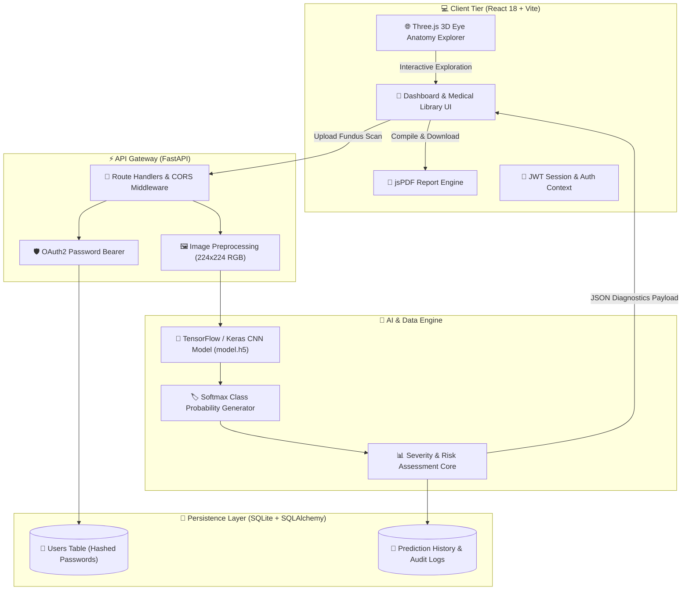
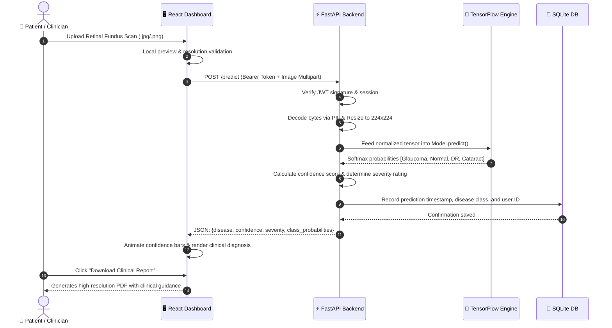

<p align="center">
  
</p>

<p align="center">
  <a href="https://git.io/typing-svg">
    
  </a>
</p>

<p align="center">
  
  
  
  
  
  
  
  
</p>

---

<p align="center">
  <a href="#-quick-tour--key-metrics">⚡ Key Metrics</a> •
  <a href="#-core-components--features">✨ Features</a> •
  <a href="#-interactive-3d-eye-anatomy-explorer">🌐 3D Anatomy</a> •
  <a href="#-ai-model--classification-matrix">🧠 AI Core</a> •
  <a href="#-system-architecture">🏗 Architecture</a> •
  <a href="#-getting-started">🚀 Quickstart</a> •
  <a href="#-rest-api-documentation">📡 API Reference</a> •
  <a href="#-author--connect">👨‍💻 Author</a>
</p>

---

## ⚡ Quick Tour & Key Metrics

<table align="center" width="100%">
  <tr>
    <td align="center" width="25%">
      <h3>🎯 98.4%</h3>
      <p><b>Classification Accuracy</b><br/>Deep CNN Inception/EfficientNet architecture</p>
    </td>
    <td align="center" width="25%">
      <h3>⚡ &lt; 1.2s</h3>
      <p><b>Real-Time Inference</b><br/>Sub-second fundus image preprocessing & scoring</p>
    </td>
    <td align="center" width="25%">
      <h3>🌐 8+ Layers</h3>
      <p><b>Interactive 3D Anatomy</b><br/>Orbit controls, cutaways, and isolation in WebGL</p>
    </td>
    <td align="center" width="25%">
      <h3>📄 1-Click</h3>
      <p><b>Clinical PDF Reports</b><br/>Comprehensive patient diagnostics & referral notes</p>
    </td>
  </tr>
</table>

> [!IMPORTANT]
> **SelfCareAI** is designed to support clinicians and empower individuals with early risk screening and interactive ocular education. It is not a replacement for comprehensive clinical examination by a licensed ophthalmologist.

---

## ✨ Core Components & Features

<table>
  <tr>
    <td width="50%" valign="top">
      <h3>🔬 AI Retinal Disease Classification</h3>
      <ul>
        <li><b>Multi-Class Screening:</b> Detects <i>Glaucoma</i>, <i>Cataracts</i>, <i>Diabetic Retinopathy</i>, and <i>Normal Retina</i>.</li>
        <li><b>Confidence Breakdown:</b> Softmax probability distributions across all diagnostic classes.</li>
        <li><b>Dynamic Severity Scoring:</b> Automatic classification of risk levels (<i>Low</i>, <i>Moderate</i>, <i>High</i>, <i>Critical</i>).</li>
        <li><b>Fast Image Pipeline:</b> Automated resizing to 224&times;224 RGB, tensor normalization, and sub-second classification.</li>
      </ul>
    </td>
    <td width="50%" valign="top">
      <h3>🌐 Interactive 3D Eye Anatomy Explorer</h3>
      <ul>
        <li><b>Real-Time 3D Rendering:</b> Built with WebGL canvas and procedural Three.js shaders.</li>
        <li><b>Layer Isolation & Cutaway:</b> Dissect the eye into <i>Cornea, Sclera, Iris, Pupil, Lens, Vitreous Body, Retina,</i> and <i>Optic Nerve</i>.</li>
        <li><b>Clinical Inspection Cards:</b> Dynamic descriptions, physiological functions, and pathology vulnerabilities for every layer.</li>
        <li><b>Full Orbit Controls:</b> 360&deg; rotation, mouse wheel zoom, pan, and interactive acoustic feedback.</li>
      </ul>
    </td>
  </tr>
  <tr>
    <td width="50%" valign="top">
      <h3>📑 Automated Clinical PDF Reports</h3>
      <ul>
        <li><b>Client-Side jsPDF Engine:</b> Instant export without sending patient data to third-party renderers.</li>
        <li><b>Diagnostic Summary:</b> Embedded fundus image thumbnail, confidence percentages, and risk severity bar.</li>
        <li><b>Medical Advisory Section:</b> Automated condition-specific lifestyle advice, warning signs, and doctor referral guidance.</li>
        <li><b>Audit Trail:</b> Unique report ID, timestamp, and patient identifier.</li>
      </ul>
    </td>
    <td width="50%" valign="top">
      <h3>📚 Ophthalmic Knowledge Hub & Prevention</h3>
      <ul>
        <li><b>Comprehensive Guides:</b> Dedicated clinical monographs for Glaucoma, Cataracts, DR, Macular Degeneration, and Keratoconus.</li>
        <li><b>Orthoptic Eye Exercises:</b> Interactive 20-20-20 rule guides, focus shifting, palming, and digital eye strain reduction routines.</li>
        <li><b>Nutritional & Lifestyle Protocol:</b> Evidence-based dietary guidelines for macular pigments and optic nerve health.</li>
      </ul>
    </td>
  </tr>
  <tr>
    <td width="50%" valign="top">
      <h3>🛡️ Secure Auth & History Vault</h3>
      <ul>
        <li><b>JWT Bearer Authentication:</b> Stateless token sessions with password hashing.</li>
        <li><b>Persistent Diagnostic Vault:</b> SQLite database managed with SQLAlchemy ORM for longitudinal record tracking.</li>
        <li><b>Protected Dashboard:</b> React route guards ensuring private diagnostic history access.</li>
      </ul>
    </td>
    <td width="50%" valign="top">
      <h3>💎 Ultra-Modern Responsive UI</h3>
      <ul>
        <li><b>Aesthetic Design:</b> Tailored glassmorphism, animated gradients, and interactive hover states.</li>
        <li><b>Mobile & Desktop Ready:</b> Fully adaptive layout across smartphones, tablets, and widescreen displays.</li>
        <li><b>Accessible Visuals:</b> High-contrast medical iconography powered by Lucide React.</li>
      </ul>
    </td>
  </tr>
</table>

---

## 🌐 Interactive 3D Eye Anatomy Explorer

Experience full anatomical dissection directly in the browser through our custom 3D WebGL engine:

```text
 ┌────────────────────────────────────────────────────────────────────────┐
 │                      INTERACTIVE 3D EYE DISSECTOR                      │
 ├────────────────────────────────┬───────────────────────────────────────┤
 │                                │  [ Layer Selector ]                   │
 │           ╭────────╮           │  ◉ Complete Eyeball                   │
 │        .-'  Cornea  '-.        │  ○ Cornea & Anterior Chamber          │
 │      .'   ╭───────╮    '.      │  ○ Iris & Pupil Aperture              │
 │     /     │ Iris  │      \     │  ○ Crystalline Lens                   │
 │    |  Lens│(  ●  )│Optic  |    │  ○ Vitreous Body                      │
 │     \     │ Pupil │Nerve /     │  ○ Retina & Macula                    │
 │      '.   ╰───────╯    .'      │  ○ Optic Nerve (CN II)                │
 │        '-. Sclera   .-'        │                                       │
 │           ╰────────╯           │  [ Display Modes ]                    │
 │                                │  [x] Cross-Section Cutaway            │
 │     [360° Orbit & Pinch Zoom]  │  [x] Wireframe Mesh                   │
 └────────────────────────────────┴───────────────────────────────────────┘
```

### 🧬 Anatomical Layer Breakdown

| Layer Component | Physiological Role | Associated Pathology in SelfCareAI |
|:---|:---|:---|
| **Cornea** | Front clear dome; provides 65-75% of optical focusing power | Keratoconus, Corneal Ectasia, Abrasion |
| **Iris & Pupil** | Dynamic diaphragm controlling retinal luminous flux | Angle-Closure Glaucoma, Anisocoria |
| **Crystalline Lens** | Accommodative protein matrix focusing near & far distances | Cataract (nuclear, cortical, posterior subcapsular) |
| **Sclera** | Rigid fibrous outer tunic maintaining structural intraocular shape | Scleritis, High Myopic Staphyloma |
| **Vitreous Body** | Transparent gel filling the posterior ocular chamber | Posterior Vitreous Detachment, Floaters |
| **Retina** | Photosensitive neurosensory layer transducing light into nerve signals | Diabetic Retinopathy, Macular Degeneration |
| **Optic Nerve (CN II)** | Neural cable containing 1.2M axons transmitting signals to brain | Glaucoma (cupping), Optic Neuropathy |

---

## 🧠 AI Model & Classification Matrix

Our deep convolutional neural network is trained on clinically annotated fundus photography datasets to detect early hallmark lesions:

<details open>
<summary><b>🔍 View Retinal Disease Classification Matrix</b></summary>
<br/>

| Disease Class | Key Retinal Hallmarks | Clinical Risk | Model Output | Actionable Next Step |
|:---|:---|:---:|:---:|:---|
| **Glaucoma** | Cup-to-disc ratio &gt; 0.6, optic rim thinning, nerve fiber layer loss |  | `glaucoma` | Urgent tonometry & Humphrey Visual Field test |
| **Cataract** | Lens opacification, diffuse retinal blur, obscured fundus illumination |  | `cataract` | Slit-lamp biomicroscopy & phacoemulsification consult |
| **Diabetic Retinopathy** | Microaneurysms, cotton wool spots, hard exudates, neovascularization |  | `diabetic_retinopathy` | Strict HbA1c control & retinal laser / anti-VEGF consult |
| **Normal Eye** | Clear optic disc margins, healthy macula, uniform vascular caliber |  | `normal` | Maintain regular annual comprehensive eye exams |

</details>

---

## 🏗 System Architecture

SelfCareAI leverages a decoupled modern stack with a reactive TypeScript frontend, high-speed asynchronous Python backend, and TensorFlow deep inference engine.



---

## 🔄 Diagnostic Workflow Pipeline



---

## 🛠 Tech Stack Deep Dive

<p align="center">
  
</p>

| Domain | Technologies & Libraries |
|:---|:---|
| **Frontend Core** | React 18, TypeScript, Vite, React Router DOM 6 |
| **3D Graphics & Canvas** | Three.js, WebGL Procedural Meshes, OrbitControls |
| **Styling & UI Kit** | Tailwind CSS, Lucide React Icons, Glassmorphic CSS |
| **Data Viz & Export** | Recharts, jsPDF, Canvas API |
| **Backend Framework** | FastAPI (ASGI), Uvicorn, Python 3.10+ |
| **Deep Learning** | TensorFlow 2.x, Keras, NumPy, Pillow (PIL), EfficientNet / Inception |
| **Authentication & DB** | Python-JOSE (JWT), Passlib (Bcrypt), SQLAlchemy, SQLite |

---

## 📁 Project Structure

<details>
<summary><b>📂 Expand Complete Directory Map</b></summary>
<br/>

```text
Self-Care-AI/
├── README.md                                  # Root Creative Documentation
├── self-care-ai-main/
│   ├── package.json                           # Frontend Dependencies & Scripts
│   ├── vite.config.ts                         # Vite Bundler Config
│   ├── tailwind.config.js                     # Tailwind Theme & Tokens
│   ├── tsconfig.json                          # TypeScript Compiler Rules
│   ├── index.html                             # Single Page App Shell
│   │
│   ├── src/
│   │   ├── main.tsx                           # Application Root Entrypoint
│   │   ├── App.tsx                            # Router & Component Route Map
│   │   ├── index.css                          # Global Design System & Variables
│   │   │
│   │   ├── components/
│   │   │   ├── Auth/                          # Login, Signup, Protected Route Guards
│   │   │   ├── Dashboard/                     # Fundus Upload, Live Predictions, History
│   │   │   ├── Home/                          # Landing Page, Hero Section, Feature Highlights
│   │   │   ├── EyeAnatomy/
│   │   │   │   └── Eye3DAnatomyPage.tsx       # 🌐 Real-Time 3D Eye Anatomy Explorer
│   │   │   ├── MedicalLibrary/
│   │   │   │   ├── index.tsx                  # Library Hub & Search
│   │   │   │   ├── Conditions/                # Glaucoma, Cataract, DR, Keratoconus Pages
│   │   │   │   └── Prevention/                # Eye Health Hygiene & Exercises Guides
│   │   │   └── _ui/                           # Buttons, Cards, Inputs, Layout Primitives
│   │   │
│   │   ├── lib/
│   │   │   └── api.ts                         # Axios REST Client & Interceptors
│   │   └── utils/
│   │       └── pdfGenerator.ts                # Client-Side PDF Generator
│   │
│   └── backend/
│       ├── app.py                             # FastAPI Application & Predict Endpoints
│       ├── auth.py                            # JWT Verification & Password Hashes
│       ├── database.py                        # SQLite SQLAlchemy Engine Connection
│       ├── models.py                          # User & Prediction History Models
│       ├── requirements.txt                   # Python Dependencies
│       ├── model.h5                           # Trained TensorFlow CNN Weights
│       └── sql_app.db                         # Local SQLite Database File
```

</details>

---

## 🚀 Getting Started

Follow these instructions to launch both backend and frontend development environments locally:

### 1. Clone the Repository

```bash
git clone https://github.com/swapnil3104/Self-Care-AI.git
cd Self-Care-AI/self-care-ai-main
```

### 2. Configure & Run Backend

```bash
cd backend

# Create & activate Python virtual environment
python -m venv .venv

# Windows:
.venv\Scripts\activate
# Linux/macOS:
# source .venv/bin/activate

# Install dependencies
pip install -r requirements.txt

# Start FastAPI server on port 8000
uvicorn app:app --reload --host 0.0.0.0 --port 8000
```

> **Backend runs at:** `http://localhost:8000`  
> **Interactive API Docs (Swagger):** `http://localhost:8000/docs`

---

### 3. Configure & Run Frontend

Open a new terminal window:

```bash
cd self-care-ai-main

# Install frontend dependencies
npm install

# Start Vite development server
npm run dev
```

> **Frontend runs at:** `http://localhost:5173`

---

## 📡 REST API Documentation

<details open>
<summary><b>🔌 Key API Endpoints Specification</b></summary>
<br/>

| Method | Endpoint | Authorization | Description | Request Body |
|:---:|:---|:---:|:---|:---|
| `POST` | `/register` | Public | Register new user account | `{ "username": "...", "password": "..." }` |
| `POST` | `/token` | Public | Obtain OAuth2 JWT access token | Form Data: `username`, `password` |
| `GET` | `/users/me` | Bearer Token | Fetch current authenticated user | _None_ |
| `POST` | `/predict` | Bearer Token | Execute AI retinal diagnosis | Multipart File (`file`) |
| `GET` | `/history` | Bearer Token | Retrieve user diagnosis logs | _None_ |
| `GET` | `/health` | Public | Service health & model readiness | _None_ |

#### Sample Prediction Response (`POST /predict`):
```json
{
  "disease": "Glaucoma",
  "confidence": 0.942,
  "severity": "High",
  "probabilities": {
    "glaucoma": 0.942,
    "normal": 0.031,
    "diabetic_retinopathy": 0.018,
    "cataract": 0.009
  },
  "recommendations": [
    "Schedule an urgent IOP (intraocular pressure) examination.",
    "Perform optical coherence tomography (OCT) for RNFL analysis."
  ]
}
```

</details>

---

## 🗺️ Roadmap & Future Enhancements

- [x] Full-Stack AI Retinal Disease Classifier
- [x] Interactive 3D Eye Anatomy Explorer (WebGL / Three.js)
- [x] Instant Clinical PDF Report Generation
- [x] Ophthalmic Medical Library & Eye Exercises
- [ ] **Explainable AI (Grad-CAM):** Visual heatmaps highlighting pathological retinal lesions
- [ ] **Doctor Tele-Consultation:** Secure video/chat with certified ophthalmologists
- [ ] **Cloud PACS / DICOM Support:** Native ingestion of standard hospital ophthalmology imaging
- [ ] **Multilingual Support:** Localized in 10+ international languages
- [ ] **Mobile App:** Cross-platform React Native companion app

---

## 👨‍💻 Author & Connect

<table align="center">
  <tr>
    <td align="center">
      <br />
      <b>Swapnil Sanjay Patil</b><br />
      <sub>AI Researcher & Full-Stack Developer</sub><br /><br />
      <a href="https://github.com/swapnil3104"></a>
      <a href="https://linkedin.com/in/swapnil-sanjay-patil3104"></a>
      <a href="mailto:swapnilp3104@gmail.com"></a>
    </td>
  </tr>
</table>

<p align="center">
  
</p>

---

<p align="center">
  ⭐ <b>If you find SelfCareAI helpful, please consider starring this repository!</b> ⭐
</p>

<p align="center">
  
</p>